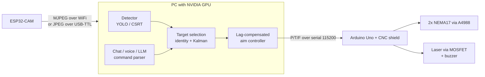

# Laser Turret

A two-axis pan/tilt turret that finds, tracks and aims at objects using a cheap ESP32-CAM, an Arduino Uno and two stepper motors, with all vision work done on a PC GPU. It can follow a single selected object, find and pop balloons with a custom-trained YOLO model, and take chat or voice commands such as "aim at the chair".

This is a hobby/education project. The laser control path is built to fail safe, but you are responsible for how you use it. **Read [Laser safety](#laser-safety) before wiring a laser.**

## Contents

- [Demo](#demo)
- [Status](#status)
- [Laser safety](#laser-safety)
- [Features](#features)
- [How it works](#how-it-works)
- [Hardware](#hardware)
- [Wiring](#wiring)
- [Repository layout](#repository-layout)
- [Installation](#installation)
- [Getting started](#getting-started)
- [Script reference](#script-reference)
- [Serial protocol](#serial-protocol)
- [Tuning](#tuning)
- [Training your own balloon detector](#training-your-own-balloon-detector)
- [Troubleshooting](#troubleshooting)
- [Limitations](#limitations)
- [Contributing](#contributing)
- [License](#license)

## Demo

### Tracking mode

One object is selected and followed. The head keeps it centred while it moves, and re-locks it after it leaves and re-enters the frame.

<!-- Replace this line with the video URL (see instructions in the repo docs): github.com/user-attachments/assets/... -->

### Hunt mode

The turret scans the room, builds a list of balloons, then visits them nearest first, locks on and counts each pop. Filmed with laser goggles worn and a matte backstop behind the targets.

<!-- Replace this line with the video URL: github.com/user-attachments/assets/... -->

## Status

| Component | State |
|---|---|
| Stepper firmware, motion, calibration | Tested on hardware |
| ESP32-CAM over WiFi and over USB-TTL serial | Tested on hardware (WiFi); serial path written and compiled, less field-tested |
| `tracker.py` (colour / CSRT single-target tracking) | Tested on hardware |
| Balloon detector training (`collect_balloons.py`, `train_balloon.py`) | Run on hardware, see [metrics](#training-your-own-balloon-detector) |
| `balloon_track.py`, `hunter.py`, `voice_turret.py` | Developed against a simulated camera, detector and serial port. **Not yet validated end to end on real hardware.** Expect to tune latency and gains. |
| Laser output stage | Firmware safety logic is covered by a host-side test harness. The laser circuit itself has not been built or tested by the author yet. |

If you try it on different hardware, please open an issue with what worked and what did not.

## Laser safety

The reference build uses a 200 to 250 mW, 650 nm module. That is a **Class 3B** laser: it can cause permanent eye damage from the direct beam and from specular reflections, and it can scorch paper, fabric and dark materials.

Minimum precautions:

- Wear laser goggles rated for your wavelength (OD 4+ at 650 nm). Everyone in the room needs them while the laser is powered.
- Fit a **physical kill switch** in the laser's power line. Software is not a substitute.
- Add a 10 kOhm pull-down from the MOSFET gate to GND so the laser stays off while the Uno resets or boots.
- Never point the beam at people or animals, and do not let it reach mirrors, glass, screens or glossy surfaces. Run it facing a matte backstop.
- Do not leave it running unattended. Treat it as a device you supervise.
- Check your local regulations. Some jurisdictions restrict the sale or use of Class 3B lasers.

Software safety layers (each is independent of the others):

| Layer | Where | Behaviour |
|---|---|---|
| Off at boot | Firmware | Laser pin is driven low first thing in `setup()`. |
| Command failsafe | Firmware | No command for 200 ms switches the laser off. The PC must refresh at least every 100 ms while firing. |
| Audible warning | Firmware | Buzzer sounds 250 ms before the laser actually switches on. |
| Burn limit | Firmware | 3 s maximum continuous burn, then a forced 1.5 s cool-down. |
| Arming | PC | Nothing fires unless started with `--arm` or armed with the `A` key. Voice and LLM input cannot arm it. |
| Target gating | PC | Fires only at a detected target locked inside a small angular tolerance for several consecutive frames, and stops the instant the detection disappears. |
| Person guard | PC | A second detector forces the laser off while a person (or, in `voice_turret.py`, any animal) is in view. |
| Class restrictions | PC | `voice_turret.py` fires only at classes listed in `--fire-classes` (default: balloon). People, animals and reflective objects are always refused. |
| No-fire zones | PC | No firing when pointed below `--fire-tilt-min` or beyond `--fire-pan`. |

## Features

- Smooth closed-loop pan/tilt control with a latency-compensated aiming model: the target angle is computed from where the head was pointing when the frame was captured, then filtered with a Kalman filter. This is what removes the lag and wobble you get from naive "move toward the pixel error" control.
- Learns the camera-to-motor delay at runtime from the data instead of relying on a hand-tuned constant.
- Single-target tracking with CSRT (no colour dependence), a template gallery for identity, and whole-frame re-acquisition when the target leaves and re-enters the view.
- Custom YOLOv8-nano balloon detector with a self-labelling data collection tool (drag one box, it follows and labels the rest) and a GPU training script.
- Balloon hunter: scans the room, builds a registry of balloons in absolute angles, visits them nearest-first, locks, fires, confirms the pop, and moves on.
- Object-aware chat and voice control: map the room with a scan, then "aim at the chair", "point at the red cup on the left". Rule-based parsing works offline; an LLM (Claude API or a local Ollama model) handles free-form phrasing.
- Two camera transports: WiFi MJPEG, or raw JPEG frames over a USB-TTL cable at 2 Mbaud.
- Printable A4 foam-board blueprint for the mechanical structure.

## How it works



The PC does everything that needs compute. The Uno only executes `P<pan>,T<tilt>,F<laser>` commands and enforces the laser safety limits locally, so a crashed or stalled PC program cannot leave the laser on.

### Aiming model

Camera frames arrive tens to hundreds of milliseconds after they were captured, and the motors keep moving in the meantime. Using the pixel error directly against the current head angle therefore overshoots and oscillates. Instead:

1. Every command sent to the head is logged with a timestamp.
2. For a frame, the head angle at `now - delay` is looked up and the image error (in degrees, from the field of view) is added to it. This gives the target's absolute angle, independent of head motion.
3. A constant-velocity Kalman filter runs on the absolute angle and yields position and velocity.
4. The commanded angle is the filtered position plus velocity times a short lead time, with a velocity soft threshold (`--still`) and a deadband (`--hold`) so a stationary target produces no motion.
5. The delay itself is re-estimated from the measurement history by testing which candidate delay makes the absolute-angle track smoothest.

### Room map

During scans, every detection is converted to an absolute angle and merged into a registry (same label, within a size-dependent radius). Observations are skipped while the head is moving quickly, because the camera delay makes angles unreliable there. Objects that are expected in view but are repeatedly missing are removed, so the map follows things that move. This is what lets "aim at the chair" turn to a chair that is currently out of frame.

## Hardware

| Part | Notes |
|---|---|
| Arduino Uno + CNC Shield V3 | Shield plus two drivers in the X and Y slots |
| 2x A4988 stepper drivers | Max 1/16 microstepping; fit all three MS jumpers |
| 2x NEMA17 stepper motors | Reference build: Minebea 17PM-K210 |
| ESP32-CAM (AI-Thinker) | WiFi, or USB-TTL adapter for the serial transport |
| USB-TTL (3.3 V logic) adapter | Optional, for the serial camera and for flashing the ESP32-CAM |
| 12 V supply for the shield | Size it for the motor current you set on the drivers |
| Laser module, 650 nm | Optional. Driven through a logic-level MOSFET, never straight from a pin |
| Logic-level N-MOSFET, 10 kOhm and 220 Ohm resistors | Laser switching and gate pull-down |
| Active buzzer | Warning tone before the laser switches on |
| Kill switch | In the laser power line |
| Foam board, M3 hardware | See `foam_blueprint/` |
| PC | Windows or Linux. An NVIDIA GPU is strongly recommended for YOLO (developed on an RTX 3050 Laptop, 4 GB). |

Set each A4988 current limit (Vref) according to your motor's rated current and the driver's sense resistors. Check your own datasheets rather than copying a number.

## Wiring

Pan and tilt use the CNC shield X and Y slots. Remove the shield's EN-to-GND jumper: the firmware drives the enable pin.

| Function | Uno pin | Shield label |
|---|---|---|
| Pan step / dir | D2 / D5 | X STEP / X DIR |
| Tilt step / dir | D3 / D6 | Y STEP / Y DIR |
| Driver enable | D8 | EN |
| Laser MOSFET gate | D12 | SpnEn (through 220 Ohm) |
| Buzzer (+) | A3 | CoolEn |

Microstepping is fixed at 1/16: `200 steps x 16 / 360 = 8.889 steps/deg`. If you change it, update `PAN_STEPS_PER_DEG` and `TILT_STEPS_PER_DEG` in the firmware.

ESP32-CAM serial wiring (when using `esp32_cam_serial`):

| USB-TTL | ESP32-CAM |
|---|---|
| 5V | 5V |
| GND | GND |
| TX | U0R (GPIO3) |
| RX | U0T (GPIO1) |

To flash, connect GPIO0 to GND, press reset, upload, then remove the jumper and reset again.

Laser stage: Uno D12 -> 220 Ohm -> MOSFET gate, 10 kOhm gate to GND, laser module between the supply and the MOSFET drain, kill switch in the supply line.

## Repository layout

```
.
├── turret_uno_v2/turret_uno_v2.ino     Uno firmware with the laser safety logic (use this one)
├── turret_uno/turret_uno.ino           Earlier firmware (700 ms failsafe, no buzzer); kept for reference
├── stepper_test/stepper_test.ino       Motor/driver bring-up test, no laser access
├── esp32_cam/CameraWebServer.ino       ESP32-CAM WiFi stream with fixed default settings
├── esp32_cam_serial/esp32_cam_serial.ino  ESP32-CAM JPEG-over-serial stream
├── foam_blueprint/                     A4 foam-board cutting template (PDF) and generator
└── tracker/
    ├── turret_common.py                Camera readers, Kalman filter, tracker factory, helpers
    ├── tracker.py                      Single-target tracker: colour, YOLO or CSRT
    ├── balloon_track.py                Follow one balloon with a trained YOLO model (no laser)
    ├── hunter.py                       Scan, find, lock, fire at, and count balloons
    ├── voice_turret.py                 Chat / voice / LLM control of aiming and firing
    ├── collect_balloons.py             Self-labelling dataset builder
    └── train_balloon.py                GPU training of the balloon detector
```

## Installation

### Python (PC)

```
python -m venv .venv
.venv\Scripts\activate            # Linux/macOS: source .venv/bin/activate
pip install -r requirements.txt
```

OpenCV needs the **contrib** build for the CSRT/KCF trackers, and only one OpenCV package may be installed. If `tracker.py` reports that CSRT is missing:

```
pip uninstall -y opencv-python opencv-python-headless
pip install "opencv-contrib-python==4.11.0.86"
```

OpenCV 5.x does not ship the legacy trackers.

### GPU

On Windows, `pip install ultralytics` often pulls the CPU-only PyTorch. Check with `python -c "import torch; print(torch.cuda.is_available())"`. If it prints `False`:

```
pip uninstall -y torch torchvision
pip install torch torchvision --index-url https://download.pytorch.org/whl/cu124
```

Use `cu121` if your driver is older (`nvidia-smi` shows the driver version).

### Firmware

1. Arduino IDE: install the **AccelStepper** library.
2. Flash `turret_uno_v2/turret_uno_v2.ino` to the Uno. Close the Serial Monitor afterwards so the PC scripts can open the port.
3. ESP32-CAM, WiFi: edit `ssid` and `password` in `esp32_cam/CameraWebServer.ino`, select board "AI Thinker ESP32-CAM", flash. The stream is `http://<camera-ip>:81/stream`.
4. ESP32-CAM, serial: flash `esp32_cam_serial/esp32_cam_serial.ino` instead and pass `--source serial:COMx`.

## Getting started

Work through these in order. Each step isolates one failure domain.

1. **Motors.** Flash `stepper_test.ino`, confirm each axis makes exactly one revolution per test turn, in the expected direction, without buzzing. If it makes two revolutions, your microstepping is not what the sketch assumes (A4988 tops out at 1/16).
2. **Firmware and direction.** Flash `turret_uno_v2.ino`. Connect the Uno and send `P20,T0,F0` from a serial monitor to see the pan axis move. Use `--invert-pan` / `--invert-tilt` in the scripts if an axis moves the wrong way.
3. **Camera.** Open the stream in a browser. The ESP32 sketch applies fixed defaults (QVGA, horizontal mirror on) on every boot; the PC scripts re-apply them over HTTP when the source is a URL.
4. **Single-target tracking.** 
   ```
   python tracker.py --source http://<camera-ip>:81/stream --port COM7 --track csrt --invert-pan --invert-tilt
   ```
   Drag a box around any object.
5. **Balloon model.** Collect data and train (see [below](#training-your-own-balloon-detector)), then test detection and following without any laser:
   ```
   python balloon_track.py --source http://<camera-ip>:81/stream --port COM7 --invert-pan --invert-tilt
   ```
6. **Hunter dry run.** Without `--arm` the whole hunt runs but the laser is never commanded on:
   ```
   python hunter.py --source http://<camera-ip>:81/stream --port COM7 --model balloon.pt --invert-pan --invert-tilt
   ```
7. **Laser.** Only after the previous steps are solid, wire the laser stage, put on goggles, and bench-test the laser with the aiming head pointed at a backstop. Then add `--arm` (or press `A`).
8. **Voice and chat.**
   ```
   python voice_turret.py --source http://<camera-ip>:81/stream --port COM7 --invert-pan --invert-tilt --voice --llm claude
   ```

For a camera on a USB-TTL cable, replace the source with `serial:COM5`. Run with `--latency 0.08` as a starting point; the delay is also learned automatically.

## Script reference

Run any script with `-h` for the full option list. The most useful options:

### `tracker.py`

Modes: colour (`--color blue --select`), YOLO (`--classes person`), or appearance tracking (`--track csrt|kcf|mosse`, drag a box).

| Option | Meaning |
|---|---|
| `--source` | Webcam index, stream URL, or `serial:COMx` |
| `--port` | Uno serial port |
| `--kp`, `--max-rate` | Speed of the control loop |
| `--still`, `--hold` | Suppress motion on a stationary target |
| `--latency`, `--head-lag`, `--lead` | Delay model and prediction lead |
| `--reacq`, `--verify` | Re-acquisition and identity-check thresholds |
| `--invert-pan`, `--invert-tilt` | Flip axis direction |
| `--arm` | Allow the laser (also the `A` key) |

Keys: left click select, `c` clear, `h` home, `a` arm, `q` quit.

### `balloon_track.py`

Follows a single balloon with `balloon.pt`. Never commands the laser on. Click a balloon to lock it; with nothing locked it takes the one nearest the centre. Keeps its identity by matching detections to the Kalman prediction inside a gate that widens while the balloon is hidden.

Options of note: `--gate`, `--coast`, `--reacq-wait`, `--strict` (never switch balloons), `--no-turret` (test the detector on a webcam with no motors).

### `hunter.py`

State machine: `SCAN -> PLAN -> GOTO -> TRACK (fire) -> PLAN -> DONE`.

| Option | Meaning |
|---|---|
| `--mode hunt\|free` | Pop everything found once, or keep sweeping until quit |
| `--count N` | Stop after N balloons |
| `--arm` | Allow firing; otherwise a dry run |
| `--scan-range`, `--scan-tilts`, `--scan-speed` | Scan pattern |
| `--lock-tol`, `--lock-frames` | How tight and how long a lock must be before firing |
| `--dwell` | Maximum laser time per attempt |
| `--pop-confirm` | Seconds a balloon must be gone while firing to count as popped |
| `--fire-pan`, `--fire-tilt-min`, `--fire-tilt-max` | No-fire zone limits |
| `--no-person-guard` | Disable the person guard (not recommended) |

Keys: `q` quit, `a` arm, `h` home, `p` pause, `r` reset the registry.

### `voice_turret.py`

Text in the terminal, or press `V` in the video window to speak.

| Phrase | Result |
|---|---|
| "scan the room" / "what do you see" | Sweep, map objects, list them |
| "aim at the chair" | Turn to it (from the map if out of view), lock and track |
| "point at the table on the left", "the red cup", "the biggest bottle" | Qualifiers: left/right/top/bottom/nearest/biggest/smallest/center and basic colours |
| "fire" / "aim at the balloon and fire" | One pulse, only if armed and allowed |
| "stop", "home", "unlock" | Laser off / return to centre / release target |

Detection: COCO-trained YOLOv8 (80 everyday classes) by default, plus your balloon model if `balloon.pt` exists. `--detector world` switches to YOLO-World so you can name arbitrary objects.

Parsing: rules run first (instant, offline). If the sentence is not understood and `--llm claude` or `--llm ollama` is set, the LLM converts it to a JSON command. The result is validated in code; the LLM cannot arm the laser, change safety settings, or bypass class restrictions.

Voice: `faster-whisper` (GPU if available), push-to-talk. `--speak` enables spoken replies.

Laser offset: if the laser is mounted away from the camera axis, set `--laser-off-pan` and `--laser-off-tilt` (degrees, positive = right/up) to the position where the dot lands relative to the image centre. A cross marks the aim point in the window.

## Serial protocol

115200 baud, newline-terminated, 8N1.

| Command | Effect |
|---|---|
| `P<deg>,T<deg>,F<0\|1>` | Move to pan/tilt angle (any field optional) and request laser off/on |
| `H` | Return to 0,0 with the laser off |
| `X` | Emergency stop: drivers disabled, laser and buzzer off |

The firmware replies `OK` after each command. Angles are clamped to the soft limits in the firmware (default pan +/-90, tilt -30 to +45). The laser request must be refreshed within 200 ms to stay on.

## Tuning

| Symptom | Adjust |
|---|---|
| Head overshoots or oscillates | Lower `--kp`; check `--latency` against the delay the script prints |
| Head lags a moving target | Raise `--lead` slightly; confirm the learned delay is sensible |
| Jitter on a stationary target | Raise `--hold` (degrees) or `--still` (deg/s) |
| Wrong direction on one axis | `--invert-pan` / `--invert-tilt` |
| Jerky motion | Lower firmware `ACCEL`; make sure the camera is not buffering frames |
| Picture is delayed | Use the serial transport, lower resolution, or fix WiFi signal; frames are always read on a background thread that keeps only the newest |
| Laser dot lands off the target | Set `--laser-off-pan/--laser-off-tilt`; parallax grows at short range |

## Training your own balloon detector

1. **Collect.** `python collect_balloons.py --source <camera>`. Drag a box around a balloon once; it follows with CSRT, tightens the box onto the balloon outline with GrabCut, and saves a labelled picture every few frames into `balloon_data/`. Pictures are assigned to train/validation in blocks of 40 to limit leakage between near-identical frames. Press `n` to save a "no balloon" picture.
2. **Train.** `python train_balloon.py --data balloon_data/data.yaml`. Uses the GPU, mixed precision and image caching, refuses to silently fall back to CPU, and copies the best weights to `balloon.pt`.
3. **Check.** Look at `results.png`, the PR and F1 curves and the confusion matrix in the Ultralytics run folder.

The reference run reached precision and recall of about 0.96 and mAP50 of about 0.97 on its validation split, with F1 peaking near confidence 0.37 (the scripts default to `--conf 0.4`). Treat these as optimistic: the validation frames come from the same collection sessions as the training frames. Dataset coverage matters more than epochs. For a model that holds up, collect:

- several balloons per picture, small and distant ones, balloons near the image edges
- different backgrounds and lighting
- balloon-free pictures (10 to 20 percent of the set)

Every visible balloon in a training picture must have a box, otherwise the model learns that balloons are background.

## Troubleshooting

| Problem | Likely cause and fix |
|---|---|
| `could not open port COMx: Access is denied` | Another program (Arduino Serial Monitor, a previous script) holds the port. Close it. |
| Motor makes two revolutions per turn | Microstepping mismatch. A4988 maximum is 1/16 with all three MS jumpers fitted. |
| Motors buzz or shake at rest | Check Vref/current, wiring, and that the EN jumper was removed. Tune `--hold`. |
| CSRT or KCF missing | Install `opencv-contrib-python` 4.x and uninstall other OpenCV packages. |
| Training crashes on Windows with a "bootstrapping phase" error | Run the script as a file (`python train_balloon.py`), not via an interactive import. It is guarded with `if __name__ == "__main__"`. |
| Training reports no GPU | CPU-only PyTorch; see [GPU](#gpu). |
| Serial camera shows corrupted frames | Lower the baud rate in both the sketch and `--cam-baud`. |
| Stream is smooth in the ESP32 web page but laggy in the script | Make sure the script reads through the latest-frame reader (it does) and that no other client is connected to the stream. |
| Detections flicker between two balloons | Use `balloon_track.py --strict`, or train with more varied data. |

## Limitations

- Camera latency and stepper resolution bound the achievable accuracy. A 320x240 ESP32-CAM image limits detection of small or distant objects.
- The pixel-to-angle conversion uses a nominal field of view (`--fov-h`, `--fov-v`). Calibrate it for your lens for best accuracy.
- Absolute angles assume the base does not move and the head does not slip steps. A stalled or skipped step is not detected (open loop).
- The room map has no depth information. Parallax between camera and laser is only corrected by a fixed offset.
- A 200 to 250 mW laser pops balloons by heating the skin of the balloon, so dark balloons work best. Pale balloons absorb little red light and may not pop.
- Voice recognition accuracy depends on the microphone and room noise. Push-to-talk is used deliberately so ambient sound cannot issue commands.

## Contributing

Issues and pull requests are welcome. Useful contributions include hardware reports (other cameras, drivers, motors), a calibration tool for field of view and laser offset, closed-loop step checking, and a depth or ranging option.

When opening a pull request:

- Keep laser-related changes conservative. Do not weaken or bypass any item in the safety table, and describe how you tested a change that touches it.
- Describe the hardware you tested on.
- Keep scripts runnable with `-h` and update this README when options change.

## License

Released under the MIT License. See [LICENSE](LICENSE). The laser is dangerous; the license disclaims all liability for how you build and use this.

## Acknowledgements

Inspired by a public build video of a balloon-popping laser turret by @diaawastaken. This repository is an independent implementation and is not affiliated with or derived from that author's paid files. Built on [Ultralytics YOLO](https://github.com/ultralytics/ultralytics), [OpenCV](https://opencv.org/), [AccelStepper](https://www.airspayce.com/mikem/arduino/AccelStepper/) and [faster-whisper](https://github.com/SYSTRAN/faster-whisper).